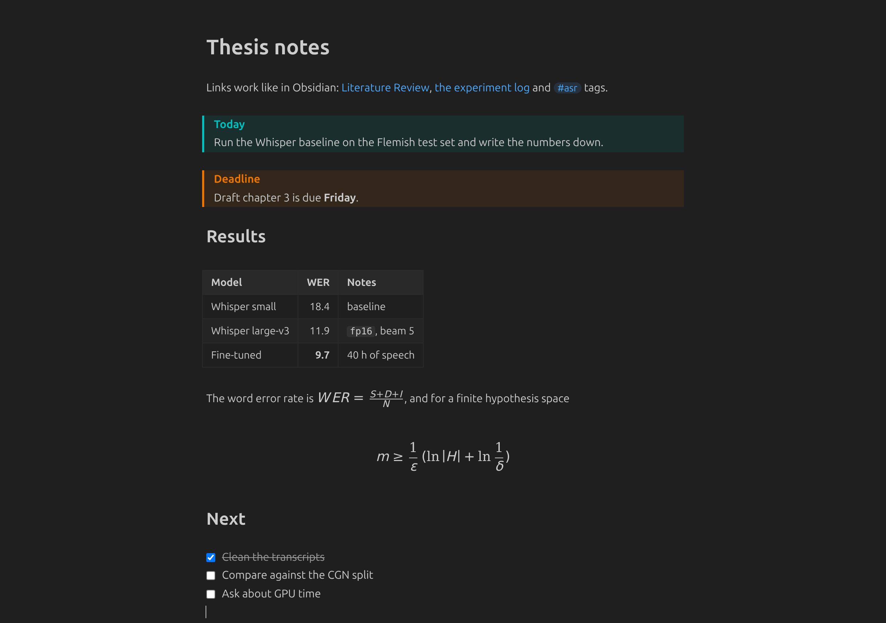
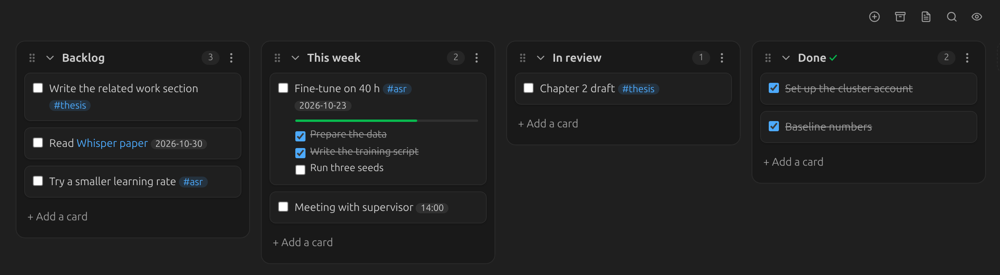
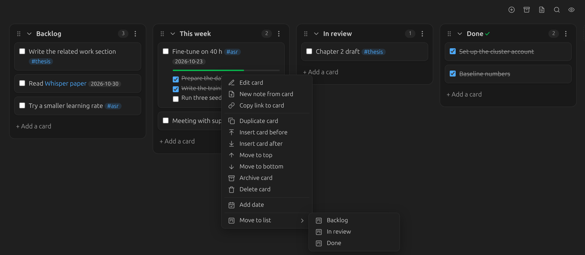

<p align="center"></p>

# Gemd

Your Obsidian vault in Visual Studio Code. Write notes, follow links and move Kanban cards in one program instead of two.



I used Obsidian for notes and VS Code for code. Gemd opens the same Markdown files inside VS Code with an Obsidian-style live preview. It never converts or rewrites your vault, so Obsidian and Gemd can open the same files side by side.

## Features

- **Live preview.** Headings, bold, links and checkboxes render as you type. The line under the cursor shows its raw Markdown, like in Obsidian.
- **Wikilinks.** `[[Note]]`, `[[Note|alias]]` and `[[folder/Note]]` open the note; a link to a missing note offers to create it. Typing `[[` suggests every note in the workspace.
- **Callouts, tables and math.** `> [!tip]` callouts in their colors, GitHub tables as real tables, and KaTeX for `$inline$` and `$$block$$` math. Prices like `$5 and $10` stay text.
- **Images.** `![[image.png]]` and `` embeds, with `|300` widths.
- **Backlinks.** A panel in the Explorer lists the notes that link to the open note.
- **Kanban boards.** Files made by the Obsidian Kanban plugin open as boards: drag cards and lists, collapse lists, archive cards or whole lists, dates with `@{2026-10-23}`, a search box, and board, list and table views. Card and list menus follow the Obsidian plugin.
- **Obsidian habits.** `Ctrl+L` turns a line into a task and ticks it. `Ctrl+N` makes a new note, and closing the last tab shows a New tab page with New note, New board and Go to file.
- **Go to Folder.** `Ctrl+Shift+O` (outside a text editor, where it stays Go to Symbol) finds any folder in the vault and shows it in the Explorer.
- **One text size.** `gemd.fontSize` sets notes, boards and the toolbar together.





## Getting started

1. Install Gemd and open your vault folder in VS Code.
2. Open a note with **Open in Gemd** in the editor title bar, or make Gemd the default for Markdown:

   ```json
   "workbench.editorAssociations": { "*.md": "gemd.markdown" }
   ```

3. Undo, redo and `Ctrl+S` are VS Code's own, so a note behaves like any other file.

`Ctrl+N` and the New tab page are on only when the workspace has an `.obsidian` folder.

## What it does not do

- Obsidian plugins do not run here. Dataview queries, Canvas, Excalidraw and the graph view stay in Obsidian.
- Links resolve by file name with exact case, while Obsidian ignores case.
- Settings come from Gemd, not from your `.obsidian` folder, except the Kanban board settings stored in each board file.

## Design

- **The file is the only state.** Every edit, from a typed letter to a card moved across the board, goes to VS Code as a change to a few lines. Nothing re-serializes the file, so front matter, spacing and line endings stay as Obsidian wrote them. The tests move every card of a real board out and back and check the file is identical byte for byte.
- **Outside changes win.** When Obsidian, Syncthing or git changes a file, the view updates. A board edit that is open at that moment is moved onto the new text, or dropped with a warning if both touched the same lines.
- **Small.** About 1,500 lines of plain JavaScript on CodeMirror 6, bundled with esbuild. No framework.

## Project structure

```
gemd/
├── src/
│   ├── extension.js   VS Code side: custom editor, links, backlinks, commands
│   ├── webview.js     webview entry: note or board, messages from VS Code
│   ├── preview.js     the note editor: live preview, tables, KaTeX math
│   ├── board.js       the Kanban board, its menus and toolbar
│   ├── shared.js      note text, inline Markdown, links
│   └── kanban.mjs     Obsidian Kanban parsing and line-level edits
├── media/             styles and icon
├── test/              node:test suites for the board and the VS Code side
└── docs/              screenshots
```

## Development

```bash
npm install
npm test                      # GEMD_BOARD=path/to/board.md adds the lossless test on a real board
npm run package               # builds gemd-<version>.vsix
code --install-extension gemd-1.0.0.vsix
```

## License

MIT.

Obsidian and Visual Studio Code are trademarks of their owners. Gemd is an independent project and is not affiliated with or endorsed by Obsidian or Microsoft.
